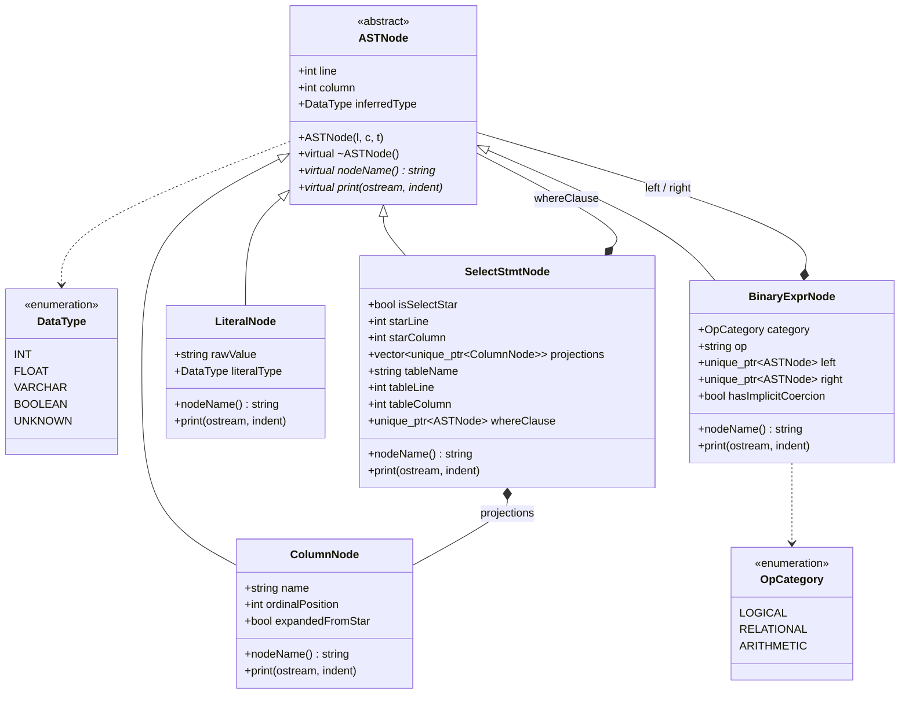
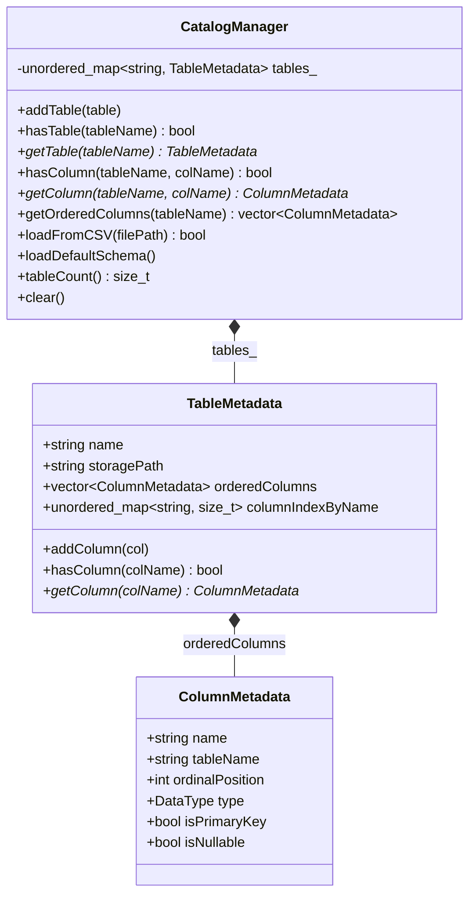

# Esquema de Traducción Dirigida por la Sintaxis (SDT) y Arquitectura del AST

**Curso:** Estructuras de Datos Avanzadas  
**Práctica de Laboratorio 6:** Analizador Semántico, Tabla de Símbolos y Construcción del AST para SQL  
**Módulo:** `semantic_analyzer` — Persona 1 (Datos, AST y Diseño)

---

## 1. Introducción y Objetivos

Este documento formaliza la **Traducción Dirigida por la Sintaxis (SDT - Syntax-Directed Translation)** para el subconjunto de SQL reconocido por el parser predictivo LL(1).

El analizador semántico opera en una arquitectura desacoplada y secuencial:
1. El **Lexer** y el **Parser LL(1)** verifican la corrección léxica y sintáctica.
2. Si la consulta es sintácticamente válida, el **SDT** construye un **Árbol de Sintaxis Abstracta (AST)** tipado y libre de tokens irrelevantes (azúcar sintáctica como comas, paréntesis y palabras clave delimitadoras).
3. Cada nodo del AST almacena la ubicación en el código fuente (`line` y `column`) heredada directamente de los tokens para permitir un reporte de errores semánticos preciso y trazable.
4. El **Analizador Semántico** contrasta el AST contra el **Catálogo del Sistema (Tabla de Símbolos)** para validar alcance de tablas y columnas, expandir comodines `*` y verificar tipos de datos.

---

## 2. Esquema de Traducción Dirigida por la Sintaxis (SDT)

A continuación se detalla la gramática atribuida formal. Los nombres de los no terminales coinciden estrictamente con las constantes de `parser_ll1::NonTerminal` (`types.h`).

### Convención de Notación de Atributos
- **`syn` / `.ast`**: Atributo sintetizado (nodo o subárbol construido que sube por la derivación).
- **`inh` / `.h`**: Atributo heredado (subárbol previo transferido hacia la derecha para resolver la recursión izquierda eliminada).
- **`tok`**: Token terminal devuelto por el analizador léxico (`tok.lexeme`, `tok.line`, `tok.column`).

### Definición Formal de Reglas Semánticas

| Producción Gramatical | Acciones Semánticas (Construcción del AST) |
|---|---|
| `CONSULTA -> SELECT_KW COLUMNA FROM_KW IDENTIFIER CONDICION SEMICOLON` | `CONSULTA.ast = new SelectStmtNode(SELECT_KW.line, SELECT_KW.column);` `CONSULTA.ast.tableName = IDENTIFIER.lexeme;` `CONSULTA.ast.tableLine = IDENTIFIER.line;` `CONSULTA.ast.tableColumn = IDENTIFIER.column;` `CONSULTA.ast.projections = COLUMNA.list;` `CONSULTA.ast.isSelectStar = COLUMNA.isStar;` `CONSULTA.ast.starLine = COLUMNA.starLine;` `CONSULTA.ast.starColumn = COLUMNA.starCol;` `CONSULTA.ast.whereClause = CONDICION.ast;` |
| `COLUMNA -> STAR` | `COLUMNA.isStar = true;` `COLUMNA.starLine = STAR.line;` `COLUMNA.starCol = STAR.column;` `COLUMNA.list = empty_list;` |
| `COLUMNA -> ID` | `COLUMNA.isStar = false;` `COLUMNA.list = ID.list;` |
| `ID -> IDENTIFIER ID_P` | `ID_P.h = [ new ColumnNode(IDENTIFIER.lexeme, IDENTIFIER.line, IDENTIFIER.column) ];` `ID.list = ID_P.syn;` |
| `ID_P_1 -> COMMA ID` | `ID_P_1.syn = concat(ID_P_1.h, ID.list);` |
| `ID_P -> ε` | `ID_P.syn = ID_P.h;` |
| `CONDICION -> WHERE_KW EXPR_COND` | `CONDICION.ast = EXPR_COND.ast;` |
| `CONDICION -> ε` | `CONDICION.ast = nullptr;` |
| `EXPR_COND -> EXPR_AND EXPR_COND_P` | `EXPR_COND_P.h = EXPR_AND.ast;` `EXPR_COND.ast = EXPR_COND_P.syn;` |
| `EXPR_COND_P_1 -> OR_KW EXPR_AND EXPR_COND_P_2` | `EXPR_COND_P_2.h = new BinaryExprNode(LOGICAL, "OR", EXPR_COND_P_1.h, EXPR_AND.ast, OR_KW.line, OR_KW.column);` `EXPR_COND_P_1.syn = EXPR_COND_P_2.syn;` |
| `EXPR_COND_P -> ε` | `EXPR_COND_P.syn = EXPR_COND_P.h;` |
| `EXPR_AND -> PRED EXPR_AND_P` | `EXPR_AND_P.h = PRED.ast;` `EXPR_AND.ast = EXPR_AND_P.syn;` |
| `EXPR_AND_P_1 -> AND_KW PRED EXPR_AND_P_2` | `EXPR_AND_P_2.h = new BinaryExprNode(LOGICAL, "AND", EXPR_AND_P_1.h, PRED.ast, AND_KW.line, AND_KW.column);` `EXPR_AND_P_1.syn = EXPR_AND_P_2.syn;` |
| `EXPR_AND_P -> ε` | `EXPR_AND_P.syn = EXPR_AND_P.h;` |
| `PRED -> VAL_1 OP_COMP VAL_2` | `PRED.ast = new BinaryExprNode(RELATIONAL, OP_COMP.lexeme, VAL_1.ast, VAL_2.ast, OP_COMP.line, OP_COMP.column);` |
| `VAL -> IDENTIFIER` | `VAL.ast = new ColumnNode(IDENTIFIER.lexeme, IDENTIFIER.line, IDENTIFIER.column);` |
| `VAL -> STRING` | `VAL.ast = new LiteralNode(STRING.lexeme, DataType::VARCHAR, STRING.line, STRING.column);` |
| `VAL -> EXPR_NUM` | `VAL.ast = EXPR_NUM.ast;` |
| `OP_COMP -> EQUAL \| NOT_EQUAL \| LESS \| GREATER \| LESS_EQUAL \| GREATER_EQUAL` | `OP_COMP.lexeme = tok.lexeme;` `OP_COMP.line = tok.line;` `OP_COMP.column = tok.column;` |
| `EXPR_NUM -> TERM EXPR_NUM_P` | `EXPR_NUM_P.h = TERM.ast;` `EXPR_NUM.ast = EXPR_NUM_P.syn;` |
| `EXPR_NUM_P_1 -> PLUS TERM EXPR_NUM_P_2` | `EXPR_NUM_P_2.h = new BinaryExprNode(ARITHMETIC, "+", EXPR_NUM_P_1.h, TERM.ast, PLUS.line, PLUS.column);` `EXPR_NUM_P_1.syn = EXPR_NUM_P_2.syn;` |
| `EXPR_NUM_P_1 -> MINUS TERM EXPR_NUM_P_2` | `EXPR_NUM_P_2.h = new BinaryExprNode(ARITHMETIC, "-", EXPR_NUM_P_1.h, TERM.ast, MINUS.line, MINUS.column);` `EXPR_NUM_P_1.syn = EXPR_NUM_P_2.syn;` |
| `EXPR_NUM_P -> ε` | `EXPR_NUM_P.syn = EXPR_NUM_P.h;` |
| `TERM -> FACTOR TERM_P` | `TERM_P.h = FACTOR.ast;` `TERM.ast = TERM_P.syn;` |
| `TERM_P_1 -> STAR FACTOR TERM_P_2` | `TERM_P_2.h = new BinaryExprNode(ARITHMETIC, "*", TERM_P_1.h, FACTOR.ast, STAR.line, STAR.column);` `TERM_P_1.syn = TERM_P_2.syn;` |
| `TERM_P_1 -> SLASH FACTOR TERM_P_2` | `TERM_P_2.h = new BinaryExprNode(ARITHMETIC, "/", TERM_P_1.h, FACTOR.ast, SLASH.line, SLASH.column);` `TERM_P_1.syn = TERM_P_2.syn;` |
| `TERM_P -> ε` | `TERM_P.syn = TERM_P.h;` |
| `FACTOR -> LPAREN EXPR_NUM RPAREN` | `FACTOR.ast = EXPR_NUM.ast;` |
| `FACTOR -> INTEGER` | `FACTOR.ast = new LiteralNode(INTEGER.lexeme, DataType::INT, INTEGER.line, INTEGER.column);` |
| `FACTOR -> DECIMAL` | `FACTOR.ast = new LiteralNode(DECIMAL.lexeme, DataType::FLOAT, DECIMAL.line, DECIMAL.column);` |

---

## 3. Diagrama de Clases del AST

El diseño en C++ implementa polimorfismo mediante herencia pública y punteros inteligentes `std::unique_ptr` para garantizar la gestión estricta de memoria (evitando fallas de segmentación y fugas).

---

## 4. Arquitectura del Catálogo del Sistema (`CatalogManager`)

El catálogo de metadatos actúa como la **Tabla de Símbolos** del compilador/motor SQL.

### Características Técnicas del Catálogo:
1. **Eficiencia $O(1)$ promedio:**
   - La búsqueda de tablas se realiza en un `std::unordered_map<std::string, TableMetadata>`.
   - La búsqueda de columnas en una tabla se realiza en $O(1)$ mediante un índice hash secundario `columnIndexByName` que almacena el índice hacia el vector ordenado `orderedColumns`.
2. **Insensibilidad a Mayúsculas/Minúsculas (Case-Insensitive):**
   - Todos los identificadores (nombres de tablas y atributos) se normalizan a minúsculas internamente mediante `toLowerAscii()`, preservando el nombre canónico original en los metadatos.
3. **Soporte de Expansión de Comodín (`SELECT *`):**
   - El método `getOrderedColumns()` retorna las columnas en estricto orden posicional (1, 2, ..., N), permitiendo que el analizador semántico reemplace el comodín `*` por la lista explícita de atributos según el catálogo.
4. **Carga Persistente desde Metadatos:**
   - Se provee el método `loadFromCSV(filePath)` que lee esquemas definidos en archivos delimitados por comas (`schema.csv`), además de `loadDefaultSchema()` que precarga las 3 tablas de prueba exigidas por la rúbrica (`empleados`, `departamentos`, `proyectos`).
