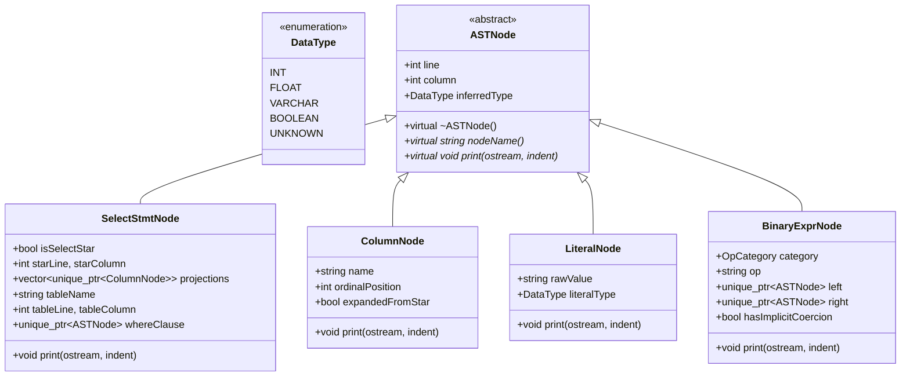
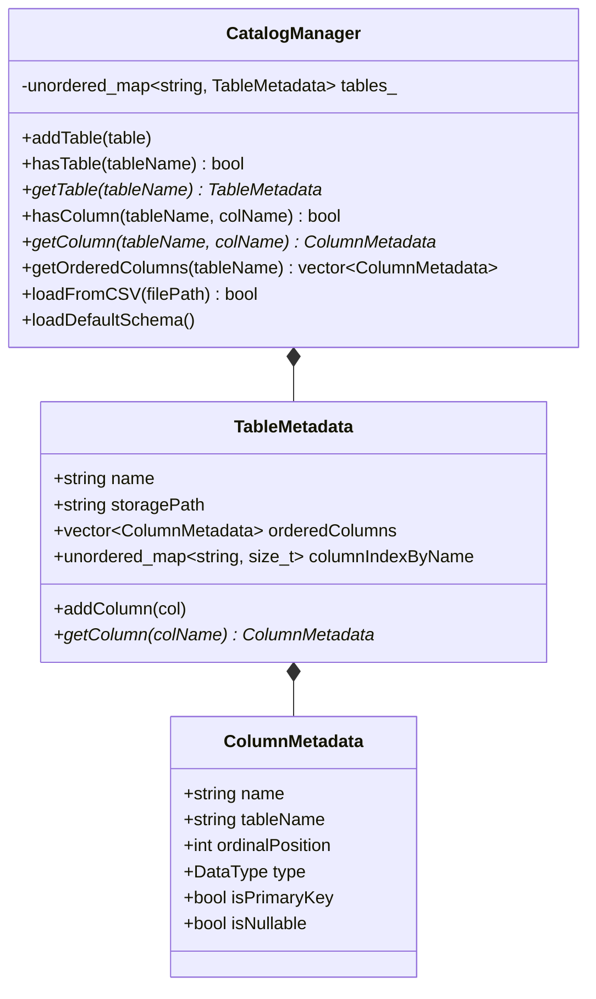

# Informe Técnico — Práctica de Laboratorio 6: Analizador Semántico, Tabla de Símbolos y Construcción del AST para SQL

**Curso:** Estructuras de Datos Avanzadas  
**Fase 2:** Construcción Progresiva del Servidor de Base de Datos Relacional  
**Integrantes:**
- Diego Canqui Ecos (Persona 2 — Motor Semántico e Integración)
- Diego Mauricio Villanueva Flores (Persona 1 — Datos, AST y Diseño)

**Repositorio GitHub:** [diego08-hub/Analizador_Lexico_EDA](https://github.com/diego08-hub/Analizador_Lexico_EDA)  
**Carpeta del Módulo:** `/semantic_analyzer`

---

## 1. Introducción y Contexto

El presente informe detalla el diseño e implementación del **Analizador Semántico**, la **Tabla de Símbolos (Catálogo del Sistema)** y la construcción del **Árbol de Sintaxis Abstracta (AST)** tipado para consultas de tipo `SELECT`.

Tras haber validado el flujo léxico en la Práctica 4 y garantizado la estructura gramatical mediante el analizador sintáctico predictivo no recursivo LL(1) en la Práctica 5, este módulo asegura la coherencia lógica y de tipos de la consulta contra el esquema relacional de la base de datos antes de una futura fase de generación y optimización de planes de ejecución.

El analizador opera exclusivamente sobre los **metadatos** del catálogo (almacenamiento en memoria o archivos `.csv`), sin requerir acceso a registros reales ni páginas físicas de disco.

---

## 2. Esquema de Traducción Dirigida por la Sintaxis (SDT) (Persona 1)

Para transformar la derivación sintáctica del parser LL(1) en un AST representativo y libre de delimitadores superfluos, se formalizó una **Gramática con Traducción Dirigida por la Sintaxis (SDT)**.

### 2.1. Atributos Sintetizados y Heredados
- **Atributos Sintetizados (`.ast`, `.syn`, `.list`):** Nodos del AST y listas de proyecciones que ascienden recursivamente desde los operandos u hojas terminales hacia los no terminales padres.
- **Atributos Heredados (`.h`):** Subárboles de expresiones previas que se transfieren de izquierda a derecha en las producciones primas (`EXPR_COND'`, `EXPR_AND'`, `EXPR_NUM'`, `TERM'`) para preservar la asociatividad a izquierda de los operadores tras haber eliminado la recursión izquierda de la gramática LL(1).

### 2.2. Reglas Formales de Traducción

```text
CONSULTA -> SELECT_KW COLUMNA FROM_KW IDENTIFIER CONDICION SEMICOLON
    {
      CONSULTA.ast = new SelectStmtNode(SELECT_KW.line, SELECT_KW.column);
      CONSULTA.ast.tableName = IDENTIFIER.lexeme;
      CONSULTA.ast.tableLine = IDENTIFIER.line;
      CONSULTA.ast.tableColumn = IDENTIFIER.column;
      CONSULTA.ast.projections = COLUMNA.list;
      CONSULTA.ast.isSelectStar = COLUMNA.isStar;
      CONSULTA.ast.starLine = COLUMNA.starLine;
      CONSULTA.ast.starColumn = COLUMNA.starCol;
      CONSULTA.ast.whereClause = CONDICION.ast;
    }

COLUMNA -> STAR
    { COLUMNA.isStar = true; COLUMNA.starLine = STAR.line; COLUMNA.starCol = STAR.column; }
COLUMNA -> ID
    { COLUMNA.isStar = false; COLUMNA.list = ID.list; }

ID -> IDENTIFIER ID_P
    { ID_P.h = [ new ColumnNode(IDENTIFIER.lexeme, IDENTIFIER.line, IDENTIFIER.column) ];
      ID.list = ID_P.syn; }
ID_P_1 -> COMMA ID
    { ID_P_1.syn = concat(ID_P_1.h, ID.list); }
ID_P -> ε
    { ID_P.syn = ID_P.h; }

CONDICION -> WHERE_KW EXPR_COND
    { CONDICION.ast = EXPR_COND.ast; }
CONDICION -> ε
    { CONDICION.ast = nullptr; }

EXPR_COND -> EXPR_AND EXPR_COND_P
    { EXPR_COND_P.h = EXPR_AND.ast; EXPR_COND.ast = EXPR_COND_P.syn; }
EXPR_COND_P_1 -> OR_KW EXPR_AND EXPR_COND_P_2
    { EXPR_COND_P_2.h = new BinaryExprNode(LOGICAL, "OR", EXPR_COND_P_1.h, EXPR_AND.ast, OR_KW.line, OR_KW.column);
      EXPR_COND_P_1.syn = EXPR_COND_P_2.syn; }
EXPR_COND_P -> ε
    { EXPR_COND_P.syn = EXPR_COND_P.h; }

EXPR_AND -> PRED EXPR_AND_P
    { EXPR_AND_P.h = PRED.ast; EXPR_AND.ast = EXPR_AND_P.syn; }
EXPR_AND_P_1 -> AND_KW PRED EXPR_AND_P_2
    { EXPR_AND_P_2.h = new BinaryExprNode(LOGICAL, "AND", EXPR_AND_P_1.h, PRED.ast, AND_KW.line, AND_KW.column);
      EXPR_AND_P_1.syn = EXPR_AND_P_2.syn; }
EXPR_AND_P -> ε
    { EXPR_AND_P.syn = EXPR_AND_P.h; }

PRED -> VAL_1 OP_COMP VAL_2
    { PRED.ast = new BinaryExprNode(RELATIONAL, OP_COMP.lexeme, VAL_1.ast, VAL_2.ast, OP_COMP.line, OP_COMP.column); }

VAL -> IDENTIFIER
    { VAL.ast = new ColumnNode(IDENTIFIER.lexeme, IDENTIFIER.line, IDENTIFIER.column); }
VAL -> STRING
    { VAL.ast = new LiteralNode(STRING.lexeme, DataType::VARCHAR, STRING.line, STRING.column); }
VAL -> EXPR_NUM
    { VAL.ast = EXPR_NUM.ast; }

EXPR_NUM -> TERM EXPR_NUM_P
    { EXPR_NUM_P.h = TERM.ast; EXPR_NUM.ast = EXPR_NUM_P.syn; }
EXPR_NUM_P_1 -> (PLUS | MINUS) TERM EXPR_NUM_P_2
    { EXPR_NUM_P_2.h = new BinaryExprNode(ARITHMETIC, op.lexeme, EXPR_NUM_P_1.h, TERM.ast, op.line, op.column);
      EXPR_NUM_P_1.syn = EXPR_NUM_P_2.syn; }
EXPR_NUM_P -> ε
    { EXPR_NUM_P.syn = EXPR_NUM_P.h; }

TERM -> FACTOR TERM_P
    { TERM_P.h = FACTOR.ast; TERM.ast = TERM_P.syn; }
TERM_P_1 -> (STAR | SLASH) FACTOR TERM_P_2
    { TERM_P_2.h = new BinaryExprNode(ARITHMETIC, op.lexeme, TERM_P_1.h, FACTOR.ast, op.line, op.column);
      TERM_P_1.syn = TERM_P_2.syn; }
TERM_P -> ε
    { TERM_P.syn = TERM_P.h; }

FACTOR -> LPAREN EXPR_NUM RPAREN
    { FACTOR.ast = EXPR_NUM.ast; }
FACTOR -> INTEGER
    { FACTOR.ast = new LiteralNode(INTEGER.lexeme, DataType::INT, INTEGER.line, INTEGER.column); }
FACTOR -> DECIMAL
    { FACTOR.ast = new LiteralNode(DECIMAL.lexeme, DataType::FLOAT, DECIMAL.line, DECIMAL.column); }
```

---

## 3. Jerarquía y Arquitectura del AST (Persona 1)

El AST se diseñó bajo una jerarquía orientada a objetos en C++, utilizando `std::unique_ptr` para garantizar la gestión estricta de memoria (evitando fugas y fallos de segmentación) y herencia pública polimórfica.



### Componentes del AST:
- **`ASTNode` (Clase Base):** Almacena coordenadas de código fuente (`line`, `column`) y el tipo de dato deducido tras la comprobación semántica (`inferredType`).
- **`SelectStmtNode`:** Nodo raíz de la consulta `SELECT`. Mantiene la tabla referenciada, la lista de proyecciones, la condición `WHERE` y si originalmente fue un `SELECT *`.
- **`ColumnNode`:** Representa una columna, su posición ordinal en el esquema relacional y si provino de una expansión de comodín.
- **`LiteralNode`:** Representa constantes (`INTEGER`, `DECIMAL`, `STRING` o `BOOLEAN`).
- **`BinaryExprNode`:** Expresiones con dos operandos clasificadas por `OpCategory` (`LOGICAL`, `RELATIONAL`, `ARITHMETIC`), marcando con `hasImplicitCoercion` promociones numéricas automáticas (ej. `INT` $\to$ `FLOAT`).

---

## 4. Tabla de Símbolos / Catálogo del Sistema (Persona 1)

El catálogo relacional se implementó en `CatalogManager` estructurado con tablas hash (`std::unordered_map`) para garantizar búsquedas en tiempo $O(1)$ promedio.



### Características Técnicas del Catálogo:
1. **Búsqueda $O(1)$ y Normalización:** Todos los nombres de tablas y columnas se normalizan internamente mediante `toLowerAscii()` para ofrecer búsquedas insensibles a mayúsculas/minúsculas sin perder los identificadores canónicos originales.
2. **Posición Ordinal:** Las columnas de cada tabla se mantienen en un vector ordenado por su posición ordinal (1, 2, ..., N), con un índice hash secundario por nombre para acceso instantáneo.
3. **Carga desde CSV (`semantic_analyzer/schema.csv`):** Permite desacoplar los metadatos del código fuente. Se incluyeron 3 tablas con esquemas mixtos:
   - **`empleados`:** `id` (INT, PK), `nombre` (VARCHAR), `edad` (INT), `salario` (FLOAT), `activo` (BOOLEAN), `departamento_id` (INT).
   - **`departamentos`:** `id` (INT, PK), `nombre` (VARCHAR), `presupuesto` (FLOAT), `activo` (BOOLEAN).
   - **`proyectos`:** `codigo` (INT, PK), `titulo` (VARCHAR), `horas_estimadas` (INT), `costo` (FLOAT), `finalizado` (BOOLEAN).

---

## 5. Motor de Verificación Semántica y Reglas (Persona 2)

El verificador semántico (`SemanticAnalyzer`) recorre recursivamente el AST generado y valida de manera estricta las 5 comprobaciones obligatorias de la práctica:

1. **Existencia de Tablas (Cláusula `FROM`):**
   - Se consulta el catálogo. Si la tabla no está registrada, se emite el error `TABLE_NOT_FOUND` con la línea y columna del identificador.
2. **Resolución de Identificadores (`SELECT` y `WHERE`):**
   - Toda columna consultada debe pertenecer a la tabla especificada en el `FROM`. Ante columnas inexistentes, se reporta `COLUMN_NOT_FOUND`.
3. **Expansión de Comodín (`SELECT *`):**
   - Si la consulta tiene `SELECT *`, el analizador obtiene las columnas de la tabla ordenadas por posición ordinal (`getOrderedColumns`) y reemplaza el asterisco por nodos `ColumnNode` explícitos marcados con `expandedFromStar = true`.
4. **Detección de Duplicados en `SELECT`:**
   - Detecta proyecciones repetidas de una misma columna. El analizador soporta políticas configurables (`REJECT_ERROR` que rechaza la consulta, o `WARN` que emite una advertencia sin invalidarla).
5. **Verificación y Coerción de Tipos (`WHERE`):**
   - **Comparaciones Relacionales (`=`, `<>`, `<`, `>`, `<=`, `>=`):**
     - Operandos del mismo tipo son válidos.
     - **Coerción Numérica Implícita:** Si un operando es `INT` y el otro `FLOAT`, se permite y se promociona a `FLOAT` marcando `hasImplicitCoercion = true`.
     - Comparaciones incompatibles (ej. `VARCHAR` vs `INT`, o booleanos evaluados con operadores de orden como `>`) reportan `TYPE_MISMATCH`.
   - **Operadores Lógicos (`AND`, `OR`):**
     - Exigen estrictamente que ambos subárboles evaluados tengan tipo inferido `BOOLEAN`.

---

## 6. Manejo de Errores y Pipeline Integrado (Persona 2)

El pipeline de ejecución desacopla limpiamente las fases del compilador:

$$\text{Consulta SQL} \longrightarrow \mathbf{Lexer} \longrightarrow \mathbf{Parser\ LL(1)} \longrightarrow \mathbf{AST\ (SDT)} \longrightarrow \mathbf{SemanticAnalyzer} \longrightarrow \mathbf{AST\ Decorado}$$

- **Cortocircuito ante Errores:** Si la consulta contiene errores léxicos o sintácticos, el pipeline se detiene de inmediato (`lexicalOrSyntaxFailed = true`), evitando ejecutar el análisis semántico sobre entradas mal formadas y previniendo fallos de memoria (*segmentation fault*).
- **Reporte Contextual:** Cada error semántico reporta tipo de error, mensaje descriptivo, identificador/operador conflictivo y coordenadas exactas de línea y columna.

---

## 7. Batería de Pruebas y Resultados

El proyecto cuenta con dos baterías de pruebas dedicadas para este laboratorio:
1. `tests/test_catalog.cpp` (Persona 1): **35 pruebas aprobadas** (100%).
2. `tests/test_semantic.cpp` (Persona 2 e Integración): **19 pruebas aprobadas** (100%).
3. Pruebas históricas (`test_lexer`, `test_grammar`, `test_parser`): **76 pruebas aprobadas**.
Total de pruebas activas del motor: **130 pruebas exitosas**.

### 7.1. Ejemplo de AST Decorado Generado

Para la consulta:
```sql
SELECT * FROM empleados WHERE edad >= 25 AND salario > 2500.50 + 100;
```

La salida generada por el AST decorado muestra la expansión del comodín, el tipado de nodos y la coerción numérica:

```text
=== AST DECORADO ===
SelectStmtNode @(1:1)
  FROM Table('empleados') @(1:15)
  SELECT Projections (expanded from '*'):
    ColumnNode('id') [type=INT, ordinal=1, from=*] @(1:8)
    ColumnNode('nombre') [type=VARCHAR, ordinal=2, from=*] @(1:8)
    ColumnNode('edad') [type=INT, ordinal=3, from=*] @(1:8)
    ColumnNode('salario') [type=FLOAT, ordinal=4, from=*] @(1:8)
    ColumnNode('activo') [type=BOOLEAN, ordinal=5, from=*] @(1:8)
    ColumnNode('departamento_id') [type=INT, ordinal=6, from=*] @(1:8)
  WHERE [type=BOOLEAN]:
    BinaryExprNode('AND', LOGICAL) [type=BOOLEAN] @(1:42)
      BinaryExprNode('>=', RELATIONAL) [type=BOOLEAN] @(1:36)
        ColumnNode('edad') [type=INT, ordinal=3] @(1:31)
        LiteralNode(25) [type=INT] @(1:39)
      BinaryExprNode('>', RELATIONAL) [type=BOOLEAN] @(1:54)
        ColumnNode('salario') [type=FLOAT, ordinal=4] @(1:46)
        BinaryExprNode('+', ARITHMETIC) [type=FLOAT, coercion=INT->FLOAT] @(1:64)
          LiteralNode(2500.50) [type=FLOAT] @(1:56)
          LiteralNode(100) [type=INT] @(1:66)
====================
```

---

## 8. Conclusiones

1. La separación de responsabilidades entre el AST y el Verificador Semántico permitió desacoplar la representación sintáctica de las reglas relacionales.
2. El uso de atributos heredados en el SDT resolvió de forma natural la precedencia y asociatividad a la izquierda de operadores en una gramática LL(1).
3. La implementación del catálogo en tablas hash con índices posicionales garantiza que la verificación semántica y la expansión de comodines se ejecuten en tiempo lineal $O(N)$ respecto al tamaño de la consulta y $O(1)$ en consultas al catálogo.
